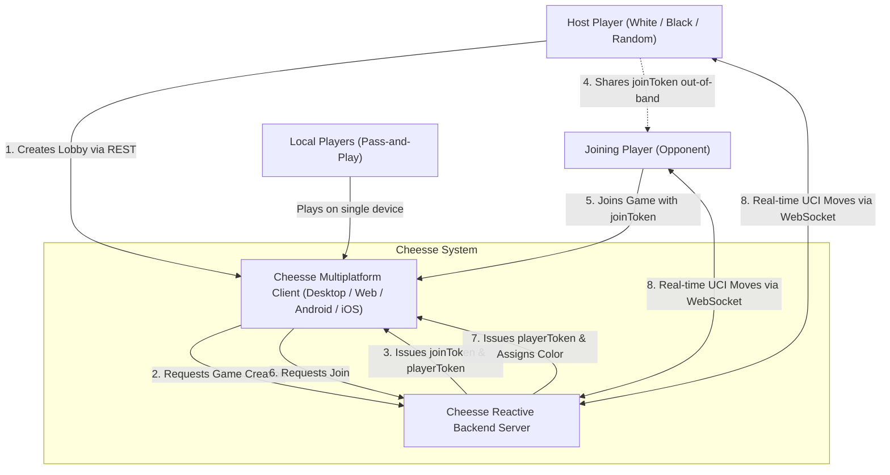

# 3. Context and Scope

Context and scope define the boundaries of the Cheesse system, showing how external actors, companion clients, and infrastructure integrate with the application.

---

## 3.1 Business Context

From a business and domain perspective, Cheesse enables players to either play locally or connect over an IP network to play synchronized multiplayer chess.



### Business Actors and External Interfaces

| Actor / External System | Description | Interaction Form |
|---|---|---|
| **Host Player** | The creator of a multiplayer game lobby. Selects color preference, receives a join token, and waits for an opponent. | Interacts via Cheesse Compose UI on their device. |
| **Guest Player** | The opponent who enters a shared join token to participate in a created match. | Interacts via Cheesse Compose UI on their device. |
| **Local Players** | Two individuals sharing a single physical device in pass-and-play mode. | Interacts via Cheesse Compose UI offline. |
| **Out-of-Band Messenger** | External channels (chat apps, email, QR codes) used by the host to transmit the alphanumeric join token to the guest. | Manual user copy-paste or link sharing. |

---

## 3.2 Technical Context

The technical context details the protocols, ports, data formats, and network channels that cross system boundaries.

```mermaid
graph LR
    subgraph Client Tier
        ClientApp["Cheesse Client (Compose Multiplatform)"]
    end

    subgraph Server Tier
        Backend["Spring Boot WebFlux Server (:server)"]
    end

    subgraph Database Tier
        DB[("PostgreSQL Database")]
    end

    ClientApp -->|HTTP POST /games JSON| Backend
    ClientApp -->|HTTP POST /games/join JSON| Backend
    ClientApp -->|HTTP GET /games/{id} JSON| Backend
    ClientApp <-->|WebSocket ws://:8080/ws/game-session/{id}?playerToken={token} JSON| Backend
    Backend <-->|R2DBC TCP Port 5432 Reactive SQL| DB
```

### Technical Interface Specifications

#### 1. REST Endpoints (HTTP/1.1 or HTTP/2, JSON)

| Method | URI Path | Request Payload | Response Payload | HTTP Status | Description |
|---|---|---|---|---|---|
| `POST` | `/games` | `{"color": "WHITE" \| "BLACK" \| "RANDOM"}` | `{"gameId": Long, "joinToken": UUID, "playerId": Long, "playerToken": UUID, "color": "WHITE" \| "BLACK"}` | `201 Created` | Creates a new game session. Allocates join token and host seat. |
| `POST` | `/games/join` | `{"token": "UUID"}` | `{"gameId": Long, "playerId": Long, "playerToken": UUID, "color": "WHITE" \| "BLACK"}` | `200 OK` / `404 Not Found` / `409 Conflict` | Claims the vacant seat in an existing lobby using the join token. |
| `GET` | `/games/{id}` | *None* | `{"id": Long, "fen": String, "pgn": String, "whitePlayerId": Long?, "blackPlayerId": Long?}` | `200 OK` / `404 Not Found` | Queries current game state by ID. |

#### 2. Real-Time Protocol (WebSocket, Port 8080)

- **URI**: `/ws/game-session/{id}?playerToken={playerToken}`
- **Authentication**: Validated at connection handshake. The query parameter `playerToken` must match the stored UUID for either the white seat or black seat for `id`. If mismatched or missing, the server closes the session with status `1008 POLICY_VIOLATION`.
- **Client to Server Messages (`ClientMessage`)**:
  - `{"type": "xyz.daaren.cheesse.api.ClientMessage.Move", "moveUci": "e2e4"}`
- **Server to Client Messages (`ServerMessage`)**:
  - `{"type": "xyz.daaren.cheesse.api.ServerMessage.GameStart"}`: Broadcast once both player sessions are active.
  - `{"type": "xyz.daaren.cheesse.api.ServerMessage.Move", "fen": "rnbqkbnr/pppppppp/8/8/4P3/8/PPPP1PPP/RNBQKBNR b KQkq e3 0 1", "startFen": "rnbqkbnr/pppppppp/8/8/8/8/PPPPPPPP/RNBQKBNR w KQkq - 0 1", "movesUci": ["e2e4"]}`: Broadcast after a valid move, carrying the full move history.
  - `{"type": "xyz.daaren.cheesse.api.ServerMessage.Error", "message": "It is not your turn"}`: Unicast reply on illegal action (also `Illegal move: ...` and `Game is over: ...`).

#### 3. Database Interface (R2DBC, Port 5432)

- **Protocol**: Reactive Relational Database Connectivity (R2DBC) over TCP.
- **Data Store**: PostgreSQL running default schema `cheesse`. Non-blocking queries via Spring Data R2DBC repositories.
