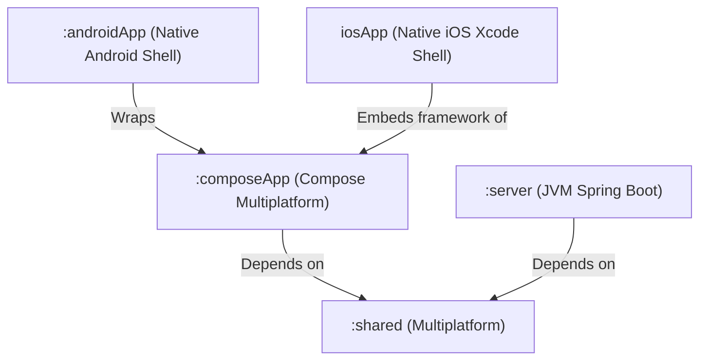

# 4. Solution Strategy

The solution strategy describes the fundamental decisions, architectural styles, and design patterns that govern Cheesse's implementation.

---

## 4.1 Fundamental Technology Decisions

| Requirement / Quality Goal | Strategic Choice | Rationale |
|---|---|---|
| Cross-Platform Consistency | **Kotlin Multiplatform (KMP) & Compose Multiplatform** | Enables sharing 100% of network DTOs, serialization logic, and chess business rules in `:shared`, as well as shared UI layouts and ViewModels in `:composeApp` across Desktop, Web, Android, and iOS. Eliminates code duplication across client platforms. |
| High Concurrency & Low Latency | **Spring Boot WebFlux & Spring Data R2DBC** | Traditional servlet containers allocate one thread per connection, which degrades under hundreds of long-lived WebSockets. WebFlux event-loop processing (Project Reactor) handles thousands of concurrent WebSocket connections and reactive PostgreSQL queries with minimal thread allocation. |
| Real-Time Bidirectional Streaming | **WebSockets via Ktor & Spring WebFlux** | HTTP polling incurs unacceptable latency and payload overhead for fast-paced chess matches. WebSockets offer sub-millisecond framing and immediate full-duplex transmission for move updates and match start notifications. |
| Modular Presentation Architecture | **Voyager ScreenModel & Material 3** | Voyager provides a lightweight, lifecycle-aware navigation abstraction tailored for Compose Multiplatform. ViewModels (`ScreenModel`) decouple business state management from UI rendering. |
| Cheat Resistance & Game Integrity | **Server-Authoritative Validation via `ChessEngineAdapter`** | Move legality, turn alternation, and board representation are verified authoritatively on the backend. Clients are never trusted with game rules; client-side move generation serves purely for interactive preview and drag responsiveness. |

---

## 4.2 Architectural Patterns & Paradigms

### 4.2.1 Multiplatform Code Sharing Architecture

Cheesse separates cross-platform responsibilities into three distinct Gradle modules:

- **`:shared`**: Houses common DTOs (`GameRequests.kt`, `GameResponses.kt`, `GameMoveMessage.kt`), constants (`SERVER_PORT`), and chess engine definitions.
- **`:composeApp`**: Implements shared Compose UI screens (`HomeScreen`, `GameScreen`, `SettingsScreen`), Voyager `ScreenModel` state machines, DI configurations (`KodeinProvider.kt`), and client network services (`ChessServerService.kt`).
- **`:server`**: Dedicated reactive JVM backend responsible for persistence, validation, and real-time session routing.
- **Platform Shells (`:androidApp`, `iosApp`)**: Minimal native wrappers providing application entry points (`MainActivity` on Android, `MainViewController` on iOS).

### 4.2.2 Model-View-Intent (MVI) & Reactive UI Flow

The client user interface follows unidirectional data flow:
1. **Model**: Immutable view states (`HomeScreenModelApi.HomeUiState`, `GameScreenModelApi.GameState`) modeled as Kotlin data classes and exposed as `StateFlow`.
2. **View**: Declarative `@Composable` functions observing states via `collectAsState()` and rendering UI widgets accordingly.
3. **Intent / Event**: User gestures (drag, tap, button click) trigger explicit methods on the `ScreenModel` (`makeMove`, `createGame`, `joinGame`).
4. **Side Effects**: Ephemeral one-shot occurrences (e.g., navigating to `GameScreen` upon match start) are emitted through buffered `SharedFlow` (`gameStartEvents`).

### 4.2.3 Layered Separation with Port/Adapter Pattern

To prevent tight coupling between WebSockets, REST, business rules, client UI, and persistence:
- **Shared Domain & Engine Adapter**: `ChessEngineAdapter` in `:shared` encapsulates the third-party `chess-core` library behind a clean domain interface (`applyMove`, `activePlayerColor`, `getBoardState`, operating on a replayable `ChessGameHistory`), isolating third-party engine logic and domain types (`ChessPiece`, `ChessSquare`, `ChessMove`, `ChessGameResult`) from both server and client presentation layers.
- **Presentation Layer**: `GameController` (REST) and `GameSessionWebSocketHandler` (WebSocket). Handlers only interact with domain services.
- **Server Domain Layer**: `GameService` acts as the core application orchestrator. It manages game lifecycle, player token verification, and move coordination.
- **Persistence Layer**: `GameRepository` manages non-blocking SQL queries and entity persistence (`GameEntity`).
