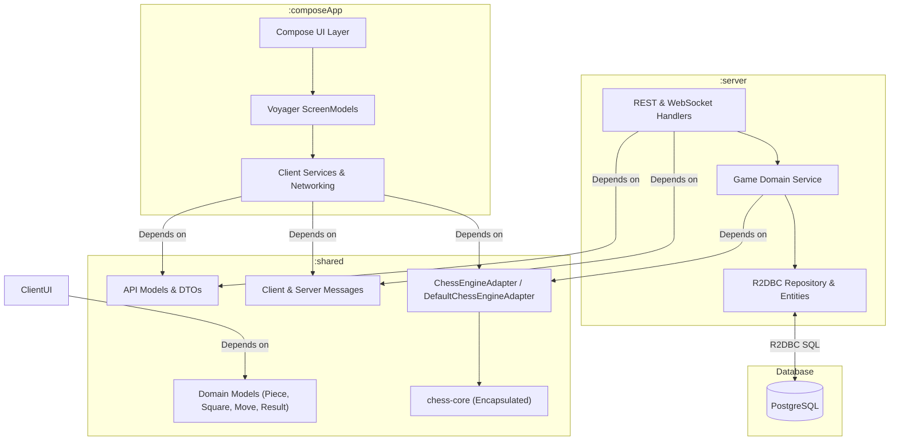
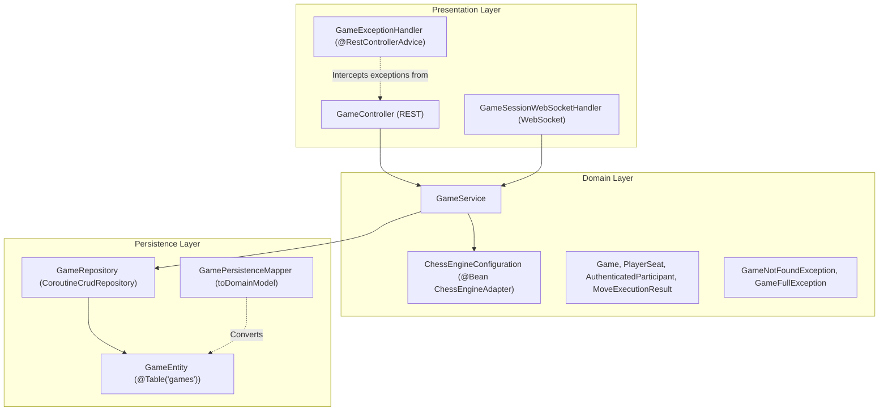

# 5. Building Block View

The building block view presents the static structural decomposition of Cheesse into modules, packages, and components.

---

## 5.1 Level 1: Whitebox Overall System

At the highest level of abstraction, the system consists of the client application (`:composeApp`), the shared library (`:shared`), the reactive server (`:server`), and the relational database (`PostgreSQL`).



### Contained Components (Level 1)

| Building Block | Primary Responsibility |
|---|---|
| **`:composeApp`** | Multiplatform client providing UI presentation, user input handling, animations, and Ktor-based networking using decoupled domain models. |
| **`:shared`** | Target-independent domain DTOs, polymorphic JSON message contracts, chess domain models, engine adapter (`ChessEngineAdapter`), and protocol constants. |
| **`:server`** | Reactive Spring Boot backend orchestrating match matchmaking, player authentication, authoritative move calculation via `ChessEngineAdapter`, and live WebSocket routing. |
| **`PostgreSQL`** | Relational storage for persistent games, board FEN/PGN state, move history, join tokens, and assigned player identifiers. |

---

## 5.2 Level 2: Component Decompositions

### 5.2.1 Whitebox `:shared`

The `:shared` module provides the shared contracts, engine abstraction, and domain models between clients and backend:

- **`xyz.daaren.cheesse.Constants`**: Defines global constants such as default `SERVER_PORT = 8080` and `DEFAULT_FEN`.
- **`xyz.daaren.cheesse.domain.chess.ChessEngineAdapter`**: Multiplatform interface and implementation (`DefaultChessEngineAdapter`) encapsulating `chess-core` operations (`applyMove`, `activePlayerColor`, `getBoardState`). `applyMove` and `getBoardState` take a `ChessGameHistory` (start FEN + UCI moves) and replay it, so draw rules that depend on earlier positions (threefold repetition) are evaluated. Moves after the game has ended are rejected with `ChessMoveResult.GameOver`.
- **`xyz.daaren.cheesse.domain.chess.ChessModels`**: Clean domain types (`ChessPiece`, `ChessPieceType`, `ChessSquare`, `ChessMove`, `ChessGameResult`, `ChessBoardState`, `ChessMoveResult`) isolating presentation layers from third-party engine classes.
- **`xyz.daaren.cheesse.api.GameRequests`**:
  - `CreateGameRequest`: Encapsulates host color preference (`WHITE`, `BLACK`, `RANDOM`).
  - `JoinGameRequest`: Contains the target `token` string for joining a lobby.
- **`xyz.daaren.cheesse.api.GameResponses`**:
  - `GameResponse`: Returns game state (`id`, `fen`, `pgn`, player IDs).
  - `CreateGameResponse`: Returns credentials for lobby creator (`gameId`, `joinToken`, `playerId`, `playerToken`, `color`).
  - `JoinGameResponse`: Returns credentials for joining player (`gameId`, `playerId`, `playerToken`, `color`).
- **`xyz.daaren.cheesse.api.GameMoveMessage`**:
  - `ClientMessage`: Sealed class for inbound frames (`Move(moveUci: String)`).
  - `ServerMessage`: Sealed class for outbound frames (`Move(fen: String, startFen: String?, movesUci: List<String>)`, `Error(message: String)`, `GameStart`).

### 5.2.2 Whitebox `:server`

The `:server` module implements a clean layered architecture:



- **`GameController`**: Spring WebFlux REST controller exposing `/games` endpoints. Methods are concise single expressions delegating directly to `GameService`.
- **`GameExceptionHandler`**: `@RestControllerAdvice` converting domain exceptions into standardized HTTP responses (404 Not Found, 409 Conflict, 400 Bad Request).
- **`GameSessionWebSocketHandler`**: WebSocket gateway managing concurrent socket sessions in `sessionsByGameId`. Delegates authentication and move execution to `GameService`.
- **`GameService`**: Core domain service. Handles transactional lobby creation, atomic player seat assignments, token authentication, and move coordination.
- **`ChessEngineConfiguration`**: Spring `@Configuration` defining a `@Bean` supplying the shared `DefaultChessEngineAdapter` to `GameService`.
- **`GameRepository`**: R2DBC repository executing reactive queries (`findByJoinToken`, atomic SQL queries `assignWhitePlayer` and `assignBlackPlayer`).

### 5.2.3 Whitebox `:composeApp`

The client module organizes UI and domain logic according to MVI:

```mermaid
graph TD
    subgraph UI Screens & Dialogs
        HS["HomeScreen"]
        GS["GameScreen"]
        SS["SettingsScreen"]
    end

    subgraph ViewModels (ScreenModels)
        HSM["HomeScreenModel"]
        GSM["GameScreenModel"]
        SVM["SettingsViewModel"]
    end

    subgraph Data & Networking
        CSS["ChessServerService / ChessServerServiceImpl"]
        GSession["GameSession (Offline / Multiplayer)"]
        HCM["HttpClientManager (createHttpClient)"]
    end

    HS --> HSM
    GS --> GSM
    SS --> SVM
    HSM --> CSS
    HSM --> GSession
    GSM --> GSession
    SVM --> CSS
    CSS --> HCM
```

- **Screens**:
  - `HomeScreen`: Displays menu options (local game, new online game dialog, join game dialog, settings button, waiting lobby display).
  - `GameScreen`: Renders the chessboard canvas, coordinate labels, piece icons, drag gestures, move target indicators, and promotion/game-over dialogs.
  - `SettingsScreen`: Allows users to configure and persist the backend server URL.
- **ScreenModels**:
  - `HomeScreenModel`: Manages lobby state, token inputs, waiting room status, and navigation events.
  - `GameScreenModel`: Manages the interactive chessboard state, move legality calculation, turn enforcement, and piece capture diffing.
- **Data & Services**:
  - `ChessServerService`: High-level networking facade for REST calls and WebSocket connection establishment.
  - `GameSession`: Polymorphic abstraction (`isTurnAllowed`, `sendMove`, `updates`) with implementations `OfflineGameSession` (local game) and `MultiplayerGameSession` (online game).
  - `KodeinProvider`: Application dependency injection module binding singletons, providers, and factory view models.

---

## 5.3 Level 3: Detailed Whitebox of Critical Components

### 5.3.1 `GameService` & `ChessEngineAdapter`

`GameService` isolates game state changes from presentation logic:

```kotlin
// Execution pipeline for a player's move
suspend fun executeMove(
    gameId: Long,
    playerId: Long,
    playerColor: PlayerColor,
    moveUci: String,
): MoveExecutionResult {
    val currentGameEntity = gameRepository.findById(gameId) ?: return MoveExecutionResult.GameNotFound
    val currentGame = currentGameEntity.toDomainModel()

    // 1. Verify turn order
    if (chessEngineAdapter.activePlayerColor(currentGame.fen) != playerColor) {
        return MoveExecutionResult.NotYourTurn
    }

    // 2. Authoritative engine move validation
    // (the adapter replays the full move history, so draws by repetition are detected)
    return when (val moveResult = chessEngineAdapter.applyMove(currentGame.history, moveUci)) {
        is ChessMoveResult.IllegalMove -> MoveExecutionResult.IllegalMove(moveUci)
        is ChessMoveResult.GameOver -> MoveExecutionResult.GameOver(moveResult.gameResult)
        is ChessMoveResult.Success -> {
            // 3. Commit new FEN/PGN and move history to database
            val savedGame =
                gameRepository
                    .save(currentGameEntity.withHistory(moveResult.history, moveResult.fen, moveResult.pgn))
                    .toDomainModel()
            MoveExecutionResult.Success(savedGame)
        }
    }
}
```

### 5.3.2 `GameSessionWebSocketHandler` Connection Registry

The WebSocket handler tracks active sessions per game using thread-safe data structures:
- `sessionsByGameId = ConcurrentHashMap<Long, MutableSet<WebSocketSession>>()`
- Upon session open: session is authenticated and added to `sessionsByGameId[gameId]`. If 2 sessions are active, `ServerMessage.GameStart` is broadcast.
- Upon message arrival: `processMove` calls `gameService.executeMove` and resolves the appropriate `SessionAction`:
  - `SessionAction.Broadcast`: Send new board FEN and the full move history to all active sessions in the match.
  - `SessionAction.Reply`: Send error notice back to the acting session only.
  - `SessionAction.Close`: Terminate connection on unrecoverable violation (e.g. malformed JSON or invalid token).
- Upon session close: The session is removed from `sessionsByGameId[gameId]`. If the set becomes empty, the game entry is evicted from memory.
