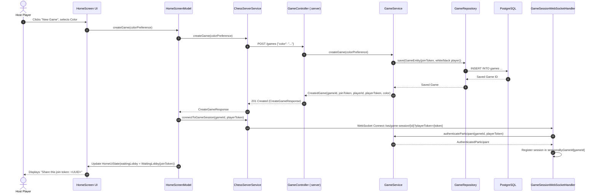
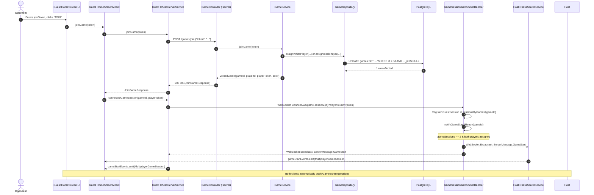
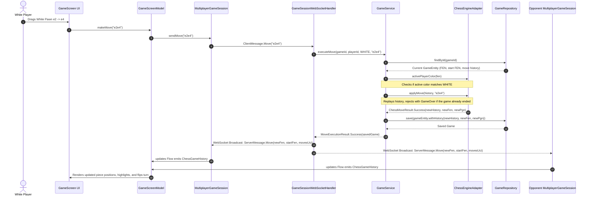

# 6. Runtime View

The runtime view explains the dynamic behavior and interactions between Cheesse's building blocks during primary operating scenarios.

---

## 6.1 Scenario 1: Game Creation & Lobby Waiting

This scenario illustrates how a host player initiates a multiplayer game, obtains credentials, and establishes a WebSocket connection while waiting for an opponent.

---

## 6.2 Scenario 2: Opponent Joins & Match Starts

This scenario demonstrates the joining flow, mutual WebSocket presence detection, and game start event broadcast.

---

## 6.3 Scenario 3: Real-Time Move Execution & Validation

This scenario details how a player makes a move on the board, how the server verifies it authoritatively, and how the new state is propagated.

---

## 6.4 Scenario 4: Local Pass-and-Play Gameplay

For local offline gameplay, no network activity occurs:

1. User clicks **"New local Game"** on `HomeScreen`.
2. `HomeScreenModel.createLocalGame()` instantiates an `OfflineGameSession`.
3. `OfflineGameSession` is initialized with an empty `ChessGameHistory` (standard opening FEN, no moves) and delegates move evaluation to `ChessEngineAdapter`.
4. When either player moves:
   - `GameScreenModel.makeMove(moveUci)` invokes `OfflineGameSession.sendMove(moveUci)`.
   - `OfflineGameSession.isTurnAllowed(color)` returns `true` regardless of turn color.
   - `chessEngineAdapter.applyMove(currentHistory, moveUci)` evaluates legality locally.
   - On success, `_updates.emit(result.history)` triggers recomposition on `GameScreen`.
