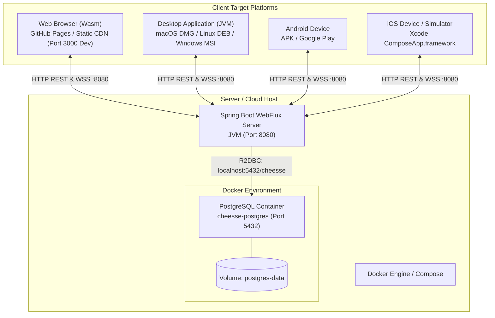

# 7. Deployment View

The deployment view describes the technical infrastructure, target platforms, container topologies, and distribution channels for Cheesse.

---

## 7.1 Infrastructure & Deployment Topology

Cheesse utilizes a hybrid architecture: a containerized, self-hostable reactive backend paired with client applications distributed across desktop, web, and mobile platforms.

---

## 7.2 Backend & Database Deployment

### 7.2.1 Database Container (`docker-compose.yml`)

The persistence tier runs as a PostgreSQL container (`cheesse-postgres`, port `5432`, database `cheesse`, persistent volume `postgres-data`, `pg_isready` healthcheck) defined in [`docker-compose.yml`](../../docker-compose.yml). The image tag is set there.

### 7.2.2 Backend Application Execution

The Spring Boot backend is compiled into a standalone executable JAR:

- **Build Command**: `./gradlew :server:bootJar`
- **Execution Command**: `java -jar server/build/libs/server-<version>.jar`
- **Environment Configuration**:
  - `DB_HOST`: Hostname of PostgreSQL instance (defaults to `localhost`).
  - `DB_PORT`: Database port (defaults to `5432`).
  - `DB_NAME`: Database name (defaults to `cheesse`).
  - `DB_USERNAME`: Database user (defaults to `postgres`).
  - `DB_PASSWORD`: Database password (defaults to `postgres`).
  - `SERVER_PORT`: HTTP/WebSocket listening port (defaults to `8080`).

---

## 7.3 Multiplatform Client Distribution

| Target Platform | Packaging Format | Build Command | Distribution Channel |
|---|---|---|---|
| **Desktop JVM** | Uber JAR / Native installer (DMG, MSI, DEB) | `./gradlew packageUberJarForCurrentOS` | GitHub Releases / Direct Download |
| **Web (Wasm)** | Wasm executable + JS glue + HTML assets | `./gradlew :composeApp:wasmJsBrowserDistribution` | Static Web Host / GitHub Pages |
| **Android** | Signed APK / Android App Bundle (`.aab`) | `./gradlew :androidApp:assembleDebug` | Google Play Store / Sideloading |
| **iOS** | Static framework (`ComposeApp.framework`) | Xcode Archive via `iosApp.xcodeproj` | Apple TestFlight / App Store |
