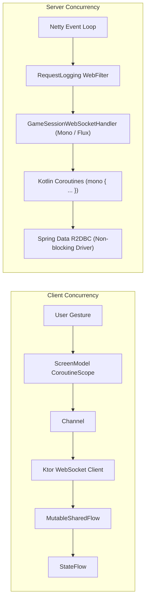
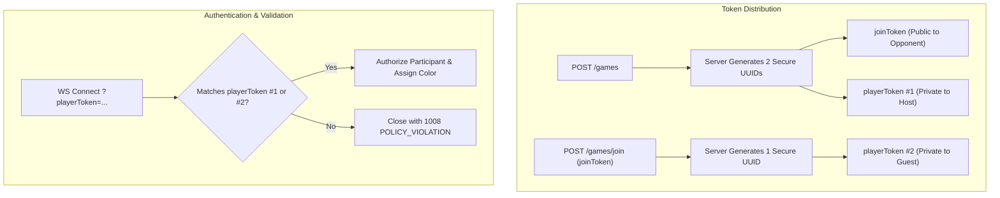

# 8. Cross-Cutting Concepts

Cross-cutting concepts govern recurring patterns, architectural principles, and shared implementations across multiple modules in Cheesse.

---

## 8.1 Domain Models & Polymorphic Serialization

Cheesse uses `kotlinx.serialization` for communication across HTTP and WebSockets.

### 8.1.1 Polymorphic WebSocket Messages

Real-time WebSocket communication relies on sealed class hierarchies annotated with `@Serializable`:

```kotlin
@Serializable
sealed class ClientMessage {
    @Serializable
    data class Move(val moveUci: String) : ClientMessage()
}

@Serializable
sealed class ServerMessage {
    @Serializable
    data class Move(
        val fen: String,
        val startFen: String? = null, // optional for compatibility with older servers
        val movesUci: List<String> = emptyList(),
    ) : ServerMessage()

    @Serializable
    data class Error(val message: String) : ServerMessage()

    @Serializable
    data object GameStart : ServerMessage()
}
```

- **Compile-Time Safety**: Sealed hierarchies ensure exhaustive handling on both client and server.
- **Backwards Compatibility**: Unknown JSON properties are ignored via `ignoreUnknownKeys = true`.

---

## 8.2 Reactive Concurrency & Streaming

Cheesse relies on asynchronous, non-blocking concurrency throughout both client and server.



- **Project Reactor & Coroutines Bridge**: Server uses `kotlinx-coroutines-reactor` (`mono { ... }`) to seamlessly interoperate between Project Reactor reactive types (`Mono`, `Flux`) and idiomatic Kotlin suspending functions.
- **Client Reactive Flows**: State is propagated reactively to the UI using `StateFlow` (for current state snapshot) and `SharedFlow` (for event streams).

---

## 8.3 Anonymous Token-Based Security & Authentication

Cheesse intentionally eliminates user registration and credential management while maintaining match integrity.



- **Separation of Secrets**: The `joinToken` only authorizes claiming a seat. Once joined, gameplay requires the secret `playerToken`.
- **Token Leakage Prevention**: Responses to clients and WebSocket broadcasts never expose the opponent's `playerToken` or `playerId`.

---

## 8.4 Error Handling & HTTP Status Mapping

Error handling follows a strict separation between transport protocols and domain errors:

### 8.4.1 REST Layer (`GameExceptionHandler`)

Domain exceptions thrown during REST calls are intercepted centrally by `@RestControllerAdvice`:

```kotlin
@RestControllerAdvice
class GameExceptionHandler {
    @ExceptionHandler(GameNotFoundException::class)
    fun handleNotFound(ex: GameNotFoundException): ResponseEntity<Map<String, String>> =
        ResponseEntity.status(HttpStatus.NOT_FOUND).body(mapOf("error" to (ex.message ?: "Not Found")))

    @ExceptionHandler(GameFullException::class)
    fun handleGameFull(ex: GameFullException): ResponseEntity<Map<String, String>> =
        ResponseEntity.status(HttpStatus.CONFLICT).body(mapOf("error" to (ex.message ?: "Conflict")))

    @ExceptionHandler(IllegalArgumentException::class)
    fun handleIllegalArgument(ex: IllegalArgumentException): ResponseEntity<Map<String, String>> =
        ResponseEntity.status(HttpStatus.BAD_REQUEST).body(mapOf("error" to (ex.message ?: "Bad Request")))
}
```

### 8.4.2 WebSocket Layer (`SessionAction`)

WebSocket errors are segregated into recoverable and unrecoverable failures:
- **Recoverable (Turn or Move Violation, Game Already Over)**: Emits `SessionAction.Reply(ServerMessage.Error("It is not your turn"))` (or `"Illegal move: ..."`, `"Game is over: ..."`).
- **Unrecoverable (Auth Failure / Malformed JSON)**: Closes connection with standard WebSocket close codes (`1008 POLICY_VIOLATION` for auth, `1007 BAD_DATA` for malformed JSON).

---

## 8.5 State Management & MVI UI Architecture

The client UI is powered by Voyager `ScreenModel`:

1. **State Immutability**: All states (`HomeUiState`, `GameState`) are immutable data classes.
2. **State Updates via Coroutines**: ViewModels mutate state using `MutableStateFlow.update { ... }` inside `screenModelScope`.
3. **Polymorphic Game Sessions**: The UI binds to `GameSession` polymorphically:
   - `OfflineGameSession.isTurnAllowed(color)` always returns `true`.
   - `MultiplayerGameSession.isTurnAllowed(color)` validates that `color == playerColor`.
   This ensures that UI logic never has to check concrete session types.

---

## 8.6 Persistence & Schema Evolution

Database persistence is handled by Spring Data R2DBC against a single normalized table:

```sql
CREATE TABLE IF NOT EXISTS games (
    id BIGSERIAL PRIMARY KEY,
    fen VARCHAR(255) NOT NULL DEFAULT 'rnbqkbnr/pppppppp/8/8/8/8/PPPPPPPP/RNBQKBNR w KQkq - 0 1',
    pgn TEXT NOT NULL DEFAULT '',
    join_token UUID NOT NULL UNIQUE,
    white_player_id BIGINT,
    white_player_token UUID,
    black_player_id BIGINT,
    black_player_token UUID
);

-- Idempotent upgrade: move history for threefold repetition (ADR-007).
ALTER TABLE games ADD COLUMN IF NOT EXISTS start_fen VARCHAR(255);
UPDATE games SET start_fen = fen WHERE start_fen IS NULL;
ALTER TABLE games ALTER COLUMN start_fen SET DEFAULT 'rnbqkbnr/pppppppp/8/8/8/8/PPPPPPPP/RNBQKBNR w KQkq - 0 1';
ALTER TABLE games ALTER COLUMN start_fen SET NOT NULL;
ALTER TABLE games ADD COLUMN IF NOT EXISTS move_history TEXT NOT NULL DEFAULT '';
```

- **Schema Evolution**: `schema.sql` runs on every startup (`spring.sql.init.mode: always`), so schema changes are written as idempotent `ALTER TABLE ... IF NOT EXISTS` statements below the `CREATE TABLE`. `fen` is a cached copy of the position reached by replaying `start_fen` + `move_history`.

- **Atomic Seat Assignment**: Concurrency-safe SQL queries ensure that two players attempting to join the same match simultaneously cannot double-claim a seat:
  ```sql
  UPDATE games
  SET black_player_id = :playerId, black_player_token = :playerToken
  WHERE id = :gameId AND black_player_id IS NULL;
  ```
  If affected row count is not 1, a `GameFullException` is raised immediately.
