# 10. Quality Requirements

This section details the quality tree and concrete quality scenarios evaluating how Cheesse satisfies its primary non-functional requirements.

---

## 10.1 Quality Tree

Cheesse's non-functional attributes are categorized based on ISO/IEC 25010:

```mermaid
graph TD
    QualityTree["Cheesse Quality Attributes"]

    QualityTree --> Performance["Performance Efficiency"]
    Performance --> Latency["Move Broadcast Latency (< 100ms)"]
    Performance --> Concurrency["High Concurrent WebSockets (> 1000)"]

    QualityTree --> Portability["Portability"]
    Portability --> CrossPlatform["Consistent UI on JVM, Web, Android, iOS"]
    Portability --> MultiTargetEngines["Target-Specific Ktor HTTP/WS Engines"]

    QualityTree --> Security["Security & Integrity"]
    Security --> CheatPrevention["Server-Authoritative Move Legality"]
    Security --> AuthProtection["Player Token Privacy (No Leakage)"]

    QualityTree --> Reliability["Reliability"]
    Reliability --> GracefulDegradation["WebSocket Connection Failures"]
    Reliability --> SchemaSafety["Atomic Matchmaking Seat Claiming"]

    QualityTree --> Maintainability["Maintainability"]
    Maintainability --> CodeSharing["Single Shared Kotlin Logic (:shared)"]
    Maintainability --> AutomatedTests["Integration Tests with Testcontainers"]
```

---

## 10.2 Quality Scenarios

| ID | Quality Attribute | Stimulus & Source | Environment | Expected Response | Measurement / Metric |
|---|---|---|---|---|---|
| **QS-01** | **Move Broadcast Latency** | Player executes a piece move on the client board. | Normal network conditions, 2 concurrent players connected via WebSockets. | The move is transmitted, validated by `ChessEngineAdapter`, persisted to PostgreSQL, and broadcast to the opponent. | Total roundtrip time from client move dispatch to opponent board update is `< 100ms`. |
| **QS-02** | **Cheat Resistance (Illegal Move)** | A compromised or modified client transmits an illegal UCI move (e.g., `e2e5` for a pawn). | Active multiplayer match. | Server rejects the move, leaves the board state unchanged, and emits a targeted `ServerMessage.Error`. | Zero invalid board states committed to the database; opponent receives no move broadcast. |
| **QS-03** | **Cheat Resistance (Turn Order)** | Black player transmits a move while it is White's turn to play. | Active multiplayer match. | Server rejects the move immediately before invoking the chess engine. | Response: `ServerMessage.Error("It is not your turn")`; match state unmodified. |
| **QS-04** | **Unauthorized WebSocket Connection** | An attacker attempts to connect to `/ws/game-session/{id}` with an invalid or empty `playerToken`. | Running server instance with active game sessions. | Handshake is rejected during authentication; socket connection is terminated immediately. | Connection closed with status `1008 POLICY_VIOLATION`. No game state leaked. |
| **QS-05** | **Race Condition on Lobby Joining** | Two players attempt to join the same single-slot game lobby simultaneously using the same `joinToken`. | Normal network, concurrent HTTP requests. | Relational database atomic query `assignBlackPlayer` (or `assignWhitePlayer`) with `WHERE ... IS NULL` allows exactly one player to claim the seat. | First player receives `200 OK`; second player receives `409 Conflict`. No corrupt game seats. |
| **QS-06** | **Cross-Platform Visual Parity** | A game is played between a Desktop JVM user and a Web Wasm user. | Cross-target deployment. | Both clients render the identical board position, piece glyphs, active turn indicator, and capture lists. | 100% visual and logical parity across targets. |
