# 1. Introduction and Goals

Cheesse is a modern, cross-platform multiplayer chess application built on Kotlin Multiplatform (KMP) and Compose Multiplatform, backed by a reactive Spring Boot service with PostgreSQL persistence. It allows players to play chess locally (pass-and-play) or online in real-time with peer-to-peer matchmaking through shareable join tokens.

---

## 1.1 Requirements Overview

### 1.1.1 Core Functional Goals

- **Local Pass-and-Play (`OfflineGameSession`)**:
  - Two players can play on a single shared screen on any supported client platform.
  - Turn rotation, legal move calculation, piece capture tracking, and game over state detection (checkmate, stalemate, draw rules) occur entirely locally without server round-trips.

- **Online Multiplayer Matchmaking (`MultiplayerGameSession`)**:
  - **Lobby Creation**: A user can create a multiplayer game, specifying a color preference (`WHITE`, `BLACK`, or `RANDOM`). The backend allocates a unique game instance, generates an anonymous `playerToken` for the host, and a shareable `joinToken`.
  - **Lobby Joining**: An opponent enters the shareable `joinToken` to join the waiting game. The backend validates token validity, ensures no duplicate joins occur, assigns the remaining color, and generates the joiner's `playerToken`.

- **Real-Time Synchronized Gameplay**:
  - Both players connect via persistent WebSockets to `/ws/game-session/{id}?playerToken={playerToken}`.
  - When both players are connected, the server automatically broadcasts a `ServerMessage.GameStart` event.
  - Moves are sent as UCI strings (`e2e4`, `g1f3`, `e7e8q` for promotion) over WebSockets.
  - Server strictly validates turn sequence, move legality, and maintains authoritative FEN and PGN states.
  - Verified move updates are broadcast to both clients instantly as FEN snapshots.

- **Interactive Chessboard UI**:
  - Drag-and-drop piece manipulation with responsive pixel-to-board coordinate mapping.
  - Move target indicator dots (circular previews for silent moves, larger rings for captures).
  - Manual board perspective rotation (rotate board 180° for White or Black perspective).
  - Pawn promotion piece selection dialog (Queen, Rook, Bishop, Knight).
  - Game over dialog announcing outcome (Checkmate with winner, Stalemate, Threefold repetition, Fifty-move rule, Insufficient material).
  - Configurable server URL in application settings with dynamic client reconnection.

---

## 1.2 Quality Goals

| Priority | Quality Goal | Motivation & Metric |
|:---|:---|:---|
| **1** | **Low Latency & High Responsiveness** | Real-time chess moves must synchronize between clients within `< 100ms` on typical networks. The backend utilizes non-blocking reactive I/O (Spring WebFlux + R2DBC + Project Reactor) to achieve high session concurrency with minimal thread footprint and memory overhead. |
| **2** | **Multiplatform Consistency & Code Reuse** | Common chess domain rules, network DTOs, serialization protocols, and UI components must be shared seamlessly across Desktop (JVM), Web (Wasm), Android, and iOS. UI behavior and piece movements must behave identically on all target platforms. |
| **3** | **Server-Authoritative Game Integrity** | Clients cannot manipulate turn order, game board state, or make illegal moves. All state transitions, legality checks, and player authentication are strictly validated on the backend before being committed to PostgreSQL and broadcast. |
| **4** | **Frictionless Anonymous Onboarding** | Players can create lobbies and join games instantly without requiring email registration, password creation, or third-party OAuth authentication. Secure random UUID tokens prevent unauthorized move injection. |

---

## 1.3 Stakeholders

| Role / Stakeholder | Goal & Perspective | Expectations from Architecture |
|---|---|---|
| **End Users / Chess Players** | Play frictionless chess games locally or with friends online. | Instant UI feedback, clear board visuals, low lag, no forced registration. |
| **Application Maintainers** | Maintain and evolve the codebase across 4 target platforms. | Unified Kotlin codebase, maximum code sharing, clean separation of concerns, fast feedback test suites. |
| **Backend & Infrastructure Operators** | Host the backend server at minimal resource cost. | Lightweight non-blocking reactive stack, low memory footprint, Docker containerization, easy PostgreSQL setup. |
| **Open Source Contributors** | Add features (move history, chess clocks, Elo matchmaking). | Standardized architecture (arc42), clear conventions (Ktlint, Gradle version catalogs), modular boundaries. |
# 2. Architecture Constraints

Architecture constraints define the organizational, technical, and process-oriented boundaries that shape Cheesse's design.

---

## 2.1 Technical Constraints

### 2.1.1 Platform & Toolchain Constraints

- **Programming Language**: Kotlin is the uniform language across all modules (`:shared`, `:server`, `:composeApp`, `:androidApp`).
- **Java Virtual Machine**: A single JVM toolchain/target version (configured in the module `build.gradle.kts` files) is used for backend compilation, desktop client execution, and Android builds.
- **Client Platforms**:
  - **Desktop (JVM)**: Native desktop distribution (macOS DMG/ICNS, Linux DEB, Windows MSI).
  - **Web (Wasm)**: Kotlin/Wasm (`wasmJs`) with browser distribution executing over modern WebAssembly-enabled browsers.
  - **Android**: Android SDK levels (`minSdk`, `compileSdk`, `targetSdk`) are defined in `gradle/libs.versions.toml`.
  - **iOS**: Target architectures `iosArm64` (physical device) and `iosSimulatorArm64` packaged as static frameworks (`ComposeApp.framework`).

### 2.1.2 Framework & Runtime Constraints

- **Backend Reactive Stack**:
  - Spring Boot built exclusively on reactive Spring WebFlux.
  - Asynchronous database communication via Spring Data R2DBC (`r2dbc-postgresql`) connecting to PostgreSQL.
  - Strict prohibition against blocking calls (no `Mono.block()`, `Thread.sleep()`, or blocking JDBC drivers).
- **Client UI & Architecture**:
  - Compose Multiplatform utilizing Material 3 components.
  - Voyager navigation framework with `ScreenModel` architecture.
  - Dependency injection powered by Kodein DI (`kodein-di-framework-compose`).
- **Networking & Serialization**:
  - Ktor Client utilizing engine adapters per target (`ktor-client-cio` on JVM, `ktor-client-darwin` on iOS, `ktor-client-js-wasm-js` on Web, `ktor-client-android` on Android).
  - WebSockets for bi-directional real-time communication.
  - `kotlinx.serialization` with polymorphic JSON encoding across both client and server.
- **Chess Engine**:
  - `xyz.daaren:chess-core` is the multiplatform chess engine for board validation, legal move computation, and FEN/PGN string parsing.

---

## 2.2 Organizational Constraints

- **Build System**: Gradle multi-project build with Kotlin DSL (`build.gradle.kts`, `settings.gradle.kts`) and typesafe project accessors (`enableFeaturePreview("TYPESAFE_PROJECT_ACCESSORS")`).
- **Centralized Dependencies**: All library and plugin versions must be managed through the Gradle Version Catalog (`gradle/libs.versions.toml`).
- **Open Source Licensing**: All components, dependencies, and media assets must adhere to permissive open-source licenses compatible with Apache 2.0 / MIT.
- **Automated Verification**:
  - Integration testing backed by Testcontainers (`testcontainers-postgresql`, managed by the Spring Boot BOM) with Spring Boot `@ServiceConnection` running on an active Docker daemon.

---

## 2.3 Conventions and Standards

- **Code Style & Linting**:
  - Ktlint (via `org.jlleitschuh.gradle.ktlint`) is enforced across all subprojects.
  - Code formatting checked via `./gradlew ktlintCheck` and corrected via `./gradlew ktlintFormat`.
  - Composable functions use PascalCase naming convention per `.editorconfig`.
- **Compiler Flags**:
  - Strict JSR-305 compiler arguments (`-Xjsr305=strict`, `-Xannotation-default-target=param-property`) enabled on the `:server` module.
- **Testing Conventions**:
  - JUnit 5 (`org.junit.jupiter`) and `kotlin.test`.
  - Test naming follows descriptive backtick syntax: `fun `anonymous users can create a game and join exactly once`()`.
- **Architectural Guidelines**:
  - Code inside `:shared/src/commonMain` must remain strictly target-agnostic without platform imports.
  - Controller methods must delegate directly to `GameService` without handling raw transport-specific try/catch blocks; errors are mapped using `@RestControllerAdvice` (`GameExceptionHandler`).
# 3. Context and Scope

Context and scope define the boundaries of the Cheesse system, showing how external actors, companion clients, and infrastructure integrate with the application.

---

## 3.1 Business Context

From a business and domain perspective, Cheesse enables players to either play locally or connect over an IP network to play synchronized multiplayer chess.

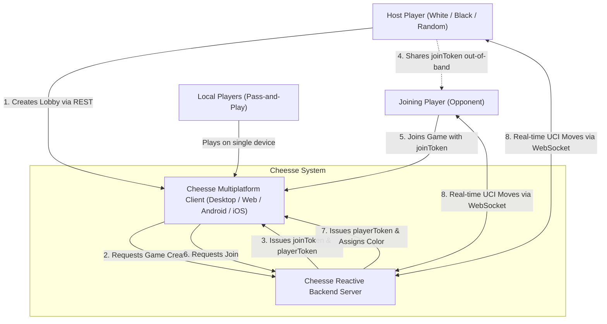

### Business Actors and External Interfaces

| Actor / External System | Description | Interaction Form |
|---|---|---|
| **Host Player** | The creator of a multiplayer game lobby. Selects color preference, receives a join token, and waits for an opponent. | Interacts via Cheesse Compose UI on their device. |
| **Guest Player** | The opponent who enters a shared join token to participate in a created match. | Interacts via Cheesse Compose UI on their device. |
| **Local Players** | Two individuals sharing a single physical device in pass-and-play mode. | Interacts via Cheesse Compose UI offline. |
| **Out-of-Band Messenger** | External channels (chat apps, email, QR codes) used by the host to transmit the alphanumeric join token to the guest. | Manual user copy-paste or link sharing. |

---

## 3.2 Technical Context

The technical context details the protocols, ports, data formats, and network channels that cross system boundaries.

```mermaid
graph LR
    subgraph Client Tier
        ClientApp["Cheesse Client (Compose Multiplatform)"]
    end

    subgraph Server Tier
        Backend["Spring Boot WebFlux Server (:server)"]
    end

    subgraph Database Tier
        DB[("PostgreSQL Database")]
    end

    ClientApp -->|HTTP POST /games JSON| Backend
    ClientApp -->|HTTP POST /games/join JSON| Backend
    ClientApp -->|HTTP GET /games/{id} JSON| Backend
    ClientApp <-->|WebSocket ws://:8080/ws/game-session/{id}?playerToken={token} JSON| Backend
    Backend <-->|R2DBC TCP Port 5432 Reactive SQL| DB
```

### Technical Interface Specifications

#### 1. REST Endpoints (HTTP/1.1 or HTTP/2, JSON)

| Method | URI Path | Request Payload | Response Payload | HTTP Status | Description |
|---|---|---|---|---|---|
| `POST` | `/games` | `{"color": "WHITE" \| "BLACK" \| "RANDOM"}` | `{"gameId": Long, "joinToken": UUID, "playerId": Long, "playerToken": UUID, "color": "WHITE" \| "BLACK"}` | `201 Created` | Creates a new game session. Allocates join token and host seat. |
| `POST` | `/games/join` | `{"token": "UUID"}` | `{"gameId": Long, "playerId": Long, "playerToken": UUID, "color": "WHITE" \| "BLACK"}` | `200 OK` / `404 Not Found` / `409 Conflict` | Claims the vacant seat in an existing lobby using the join token. |
| `GET` | `/games/{id}` | *None* | `{"id": Long, "fen": String, "pgn": String, "whitePlayerId": Long?, "blackPlayerId": Long?}` | `200 OK` / `404 Not Found` | Queries current game state by ID. |

#### 2. Real-Time Protocol (WebSocket, Port 8080)

- **URI**: `/ws/game-session/{id}?playerToken={playerToken}`
- **Authentication**: Validated at connection handshake. The query parameter `playerToken` must match the stored UUID for either the white seat or black seat for `id`. If mismatched or missing, the server closes the session with status `1008 POLICY_VIOLATION`.
- **Client to Server Messages (`ClientMessage`)**:
  - `{"type": "xyz.daaren.cheesse.api.ClientMessage.Move", "moveUci": "e2e4"}`
- **Server to Client Messages (`ServerMessage`)**:
  - `{"type": "xyz.daaren.cheesse.api.ServerMessage.GameStart"}`: Broadcast once both player sessions are active.
  - `{"type": "xyz.daaren.cheesse.api.ServerMessage.Move", "fen": "rnbqkbnr/pppppppp/8/8/4P3/8/PPPP1PPP/RNBQKBNR b KQkq e3 0 1", "startFen": "rnbqkbnr/pppppppp/8/8/8/8/PPPPPPPP/RNBQKBNR w KQkq - 0 1", "movesUci": ["e2e4"]}`: Broadcast after a valid move, carrying the full move history.
  - `{"type": "xyz.daaren.cheesse.api.ServerMessage.Error", "message": "It is not your turn"}`: Unicast reply on illegal action (also `Illegal move: ...` and `Game is over: ...`).

#### 3. Database Interface (R2DBC, Port 5432)

- **Protocol**: Reactive Relational Database Connectivity (R2DBC) over TCP.
- **Data Store**: PostgreSQL running default schema `cheesse`. Non-blocking queries via Spring Data R2DBC repositories.
# 4. Solution Strategy

The solution strategy describes the fundamental decisions, architectural styles, and design patterns that govern Cheesse's implementation.

---

## 4.1 Fundamental Technology Decisions

| Requirement / Quality Goal | Strategic Choice | Rationale |
|---|---|---|
| Cross-Platform Consistency | **Kotlin Multiplatform (KMP) & Compose Multiplatform** | Enables sharing 100% of network DTOs, serialization logic, and chess business rules in `:shared`, as well as shared UI layouts and ViewModels in `:composeApp` across Desktop, Web, Android, and iOS. Eliminates code duplication across client platforms. |
| High Concurrency & Low Latency | **Spring Boot WebFlux & Spring Data R2DBC** | Traditional servlet containers allocate one thread per connection, which degrades under hundreds of long-lived WebSockets. WebFlux event-loop processing (Project Reactor) handles thousands of concurrent WebSocket connections and reactive PostgreSQL queries with minimal thread allocation. |
| Real-Time Bidirectional Streaming | **WebSockets via Ktor & Spring WebFlux** | HTTP polling incurs unacceptable latency and payload overhead for fast-paced chess matches. WebSockets offer sub-millisecond framing and immediate full-duplex transmission for move updates and match start notifications. |
| Modular Presentation Architecture | **Voyager ScreenModel & Material 3** | Voyager provides a lightweight, lifecycle-aware navigation abstraction tailored for Compose Multiplatform. ViewModels (`ScreenModel`) decouple business state management from UI rendering. |
| Cheat Resistance & Game Integrity | **Server-Authoritative Validation via `ChessEngineAdapter`** | Move legality, turn alternation, and board representation are verified authoritatively on the backend. Clients are never trusted with game rules; client-side move generation serves purely for interactive preview and drag responsiveness. |

---

## 4.2 Architectural Patterns & Paradigms

### 4.2.1 Multiplatform Code Sharing Architecture

Cheesse separates cross-platform responsibilities into three distinct Gradle modules:

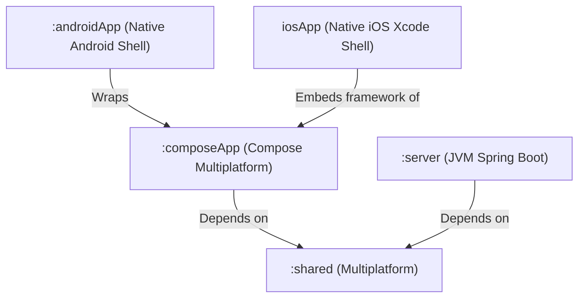

- **`:shared`**: Houses common DTOs (`GameRequests.kt`, `GameResponses.kt`, `GameMoveMessage.kt`), constants (`SERVER_PORT`), and chess engine definitions.
- **`:composeApp`**: Implements shared Compose UI screens (`HomeScreen`, `GameScreen`, `SettingsScreen`), Voyager `ScreenModel` state machines, DI configurations (`KodeinProvider.kt`), and client network services (`ChessServerService.kt`).
- **`:server`**: Dedicated reactive JVM backend responsible for persistence, validation, and real-time session routing.
- **Platform Shells (`:androidApp`, `iosApp`)**: Minimal native wrappers providing application entry points (`MainActivity` on Android, `MainViewController` on iOS).

### 4.2.2 Model-View-Intent (MVI) & Reactive UI Flow

The client user interface follows unidirectional data flow:
1. **Model**: Immutable view states (`HomeScreenModelApi.HomeUiState`, `GameScreenModelApi.GameState`) modeled as Kotlin data classes and exposed as `StateFlow`.
2. **View**: Declarative `@Composable` functions observing states via `collectAsState()` and rendering UI widgets accordingly.
3. **Intent / Event**: User gestures (drag, tap, button click) trigger explicit methods on the `ScreenModel` (`makeMove`, `createGame`, `joinGame`).
4. **Side Effects**: Ephemeral one-shot occurrences (e.g., navigating to `GameScreen` upon match start) are emitted through buffered `SharedFlow` (`gameStartEvents`).

### 4.2.3 Layered Separation with Port/Adapter Pattern

To prevent tight coupling between WebSockets, REST, business rules, client UI, and persistence:
- **Shared Domain & Engine Adapter**: `ChessEngineAdapter` in `:shared` encapsulates the third-party `chess-core` library behind a clean domain interface (`applyMove`, `activePlayerColor`, `getBoardState`, operating on a replayable `ChessGameHistory`), isolating third-party engine logic and domain types (`ChessPiece`, `ChessSquare`, `ChessMove`, `ChessGameResult`) from both server and client presentation layers.
- **Presentation Layer**: `GameController` (REST) and `GameSessionWebSocketHandler` (WebSocket). Handlers only interact with domain services.
- **Server Domain Layer**: `GameService` acts as the core application orchestrator. It manages game lifecycle, player token verification, and move coordination.
- **Persistence Layer**: `GameRepository` manages non-blocking SQL queries and entity persistence (`GameEntity`).
# 5. Building Block View

The building block view presents the static structural decomposition of Cheesse into modules, packages, and components.

---

## 5.1 Level 1: Whitebox Overall System

At the highest level of abstraction, the system consists of the client application (`:composeApp`), the shared library (`:shared`), the reactive server (`:server`), and the relational database (`PostgreSQL`).

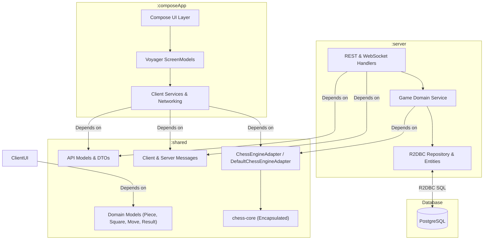

### Contained Components (Level 1)

| Building Block | Primary Responsibility |
|---|---|
| **`:composeApp`** | Multiplatform client providing UI presentation, user input handling, animations, and Ktor-based networking using decoupled domain models. |
| **`:shared`** | Target-independent domain DTOs, polymorphic JSON message contracts, chess domain models, engine adapter (`ChessEngineAdapter`), and protocol constants. |
| **`:server`** | Reactive Spring Boot backend orchestrating match matchmaking, player authentication, authoritative move calculation via `ChessEngineAdapter`, and live WebSocket routing. |
| **`PostgreSQL`** | Relational storage for persistent games, board FEN/PGN state, move history, join tokens, and assigned player identifiers. |

---

## 5.2 Level 2: Component Decompositions

### 5.2.1 Whitebox `:shared`

The `:shared` module provides the shared contracts, engine abstraction, and domain models between clients and backend:

- **`xyz.daaren.cheesse.Constants`**: Defines global constants such as default `SERVER_PORT = 8080` and `DEFAULT_FEN`.
- **`xyz.daaren.cheesse.domain.chess.ChessEngineAdapter`**: Multiplatform interface and implementation (`DefaultChessEngineAdapter`) encapsulating `chess-core` operations (`applyMove`, `activePlayerColor`, `getBoardState`). `applyMove` and `getBoardState` take a `ChessGameHistory` (start FEN + UCI moves) and replay it, so draw rules that depend on earlier positions (threefold repetition) are evaluated. Moves after the game has ended are rejected with `ChessMoveResult.GameOver`.
- **`xyz.daaren.cheesse.domain.chess.ChessModels`**: Clean domain types (`ChessPiece`, `ChessPieceType`, `ChessSquare`, `ChessMove`, `ChessGameResult`, `ChessBoardState`, `ChessMoveResult`) isolating presentation layers from third-party engine classes.
- **`xyz.daaren.cheesse.api.GameRequests`**:
  - `CreateGameRequest`: Encapsulates host color preference (`WHITE`, `BLACK`, `RANDOM`).
  - `JoinGameRequest`: Contains the target `token` string for joining a lobby.
- **`xyz.daaren.cheesse.api.GameResponses`**:
  - `GameResponse`: Returns game state (`id`, `fen`, `pgn`, player IDs).
  - `CreateGameResponse`: Returns credentials for lobby creator (`gameId`, `joinToken`, `playerId`, `playerToken`, `color`).
  - `JoinGameResponse`: Returns credentials for joining player (`gameId`, `playerId`, `playerToken`, `color`).
- **`xyz.daaren.cheesse.api.GameMoveMessage`**:
  - `ClientMessage`: Sealed class for inbound frames (`Move(moveUci: String)`).
  - `ServerMessage`: Sealed class for outbound frames (`Move(fen: String, startFen: String?, movesUci: List<String>)`, `Error(message: String)`, `GameStart`).

### 5.2.2 Whitebox `:server`

The `:server` module implements a clean layered architecture:

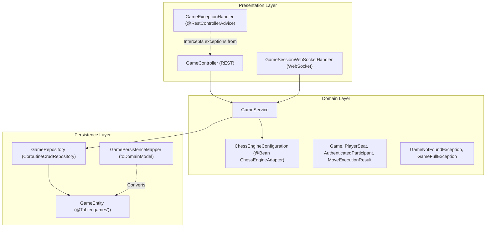

- **`GameController`**: Spring WebFlux REST controller exposing `/games` endpoints. Methods are concise single expressions delegating directly to `GameService`.
- **`GameExceptionHandler`**: `@RestControllerAdvice` converting domain exceptions into standardized HTTP responses (404 Not Found, 409 Conflict, 400 Bad Request).
- **`GameSessionWebSocketHandler`**: WebSocket gateway managing concurrent socket sessions in `sessionsByGameId`. Delegates authentication and move execution to `GameService`.
- **`GameService`**: Core domain service. Handles transactional lobby creation, atomic player seat assignments, token authentication, and move coordination.
- **`ChessEngineConfiguration`**: Spring `@Configuration` defining a `@Bean` supplying the shared `DefaultChessEngineAdapter` to `GameService`.
- **`GameRepository`**: R2DBC repository executing reactive queries (`findByJoinToken`, atomic SQL queries `assignWhitePlayer` and `assignBlackPlayer`).

### 5.2.3 Whitebox `:composeApp`

The client module organizes UI and domain logic according to MVI:

```mermaid
graph TD
    subgraph UI Screens & Dialogs
        HS["HomeScreen"]
        GS["GameScreen"]
        SS["SettingsScreen"]
    end

    subgraph ViewModels (ScreenModels)
        HSM["HomeScreenModel"]
        GSM["GameScreenModel"]
        SVM["SettingsViewModel"]
    end

    subgraph Data & Networking
        CSS["ChessServerService / ChessServerServiceImpl"]
        GSession["GameSession (Offline / Multiplayer)"]
        HCM["HttpClientManager (createHttpClient)"]
    end

    HS --> HSM
    GS --> GSM
    SS --> SVM
    HSM --> CSS
    HSM --> GSession
    GSM --> GSession
    SVM --> CSS
    CSS --> HCM
```

- **Screens**:
  - `HomeScreen`: Displays menu options (local game, new online game dialog, join game dialog, settings button, waiting lobby display).
  - `GameScreen`: Renders the chessboard canvas, coordinate labels, piece icons, drag gestures, move target indicators, and promotion/game-over dialogs.
  - `SettingsScreen`: Allows users to configure and persist the backend server URL.
- **ScreenModels**:
  - `HomeScreenModel`: Manages lobby state, token inputs, waiting room status, and navigation events.
  - `GameScreenModel`: Manages the interactive chessboard state, move legality calculation, turn enforcement, and piece capture diffing.
- **Data & Services**:
  - `ChessServerService`: High-level networking facade for REST calls and WebSocket connection establishment.
  - `GameSession`: Polymorphic abstraction (`isTurnAllowed`, `sendMove`, `updates`) with implementations `OfflineGameSession` (local game) and `MultiplayerGameSession` (online game).
  - `KodeinProvider`: Application dependency injection module binding singletons, providers, and factory view models.

---

## 5.3 Level 3: Detailed Whitebox of Critical Components

### 5.3.1 `GameService` & `ChessEngineAdapter`

`GameService` isolates game state changes from presentation logic:

```kotlin
// Execution pipeline for a player's move
suspend fun executeMove(
    gameId: Long,
    playerId: Long,
    playerColor: PlayerColor,
    moveUci: String,
): MoveExecutionResult {
    val currentGameEntity = gameRepository.findById(gameId) ?: return MoveExecutionResult.GameNotFound
    val currentGame = currentGameEntity.toDomainModel()

    // 1. Verify turn order
    if (chessEngineAdapter.activePlayerColor(currentGame.fen) != playerColor) {
        return MoveExecutionResult.NotYourTurn
    }

    // 2. Authoritative engine move validation
    // (the adapter replays the full move history, so draws by repetition are detected)
    return when (val moveResult = chessEngineAdapter.applyMove(currentGame.history, moveUci)) {
        is ChessMoveResult.IllegalMove -> MoveExecutionResult.IllegalMove(moveUci)
        is ChessMoveResult.GameOver -> MoveExecutionResult.GameOver(moveResult.gameResult)
        is ChessMoveResult.Success -> {
            // 3. Commit new FEN/PGN and move history to database
            val savedGame =
                gameRepository
                    .save(currentGameEntity.withHistory(moveResult.history, moveResult.fen, moveResult.pgn))
                    .toDomainModel()
            MoveExecutionResult.Success(savedGame)
        }
    }
}
```

### 5.3.2 `GameSessionWebSocketHandler` Connection Registry

The WebSocket handler tracks active sessions per game using thread-safe data structures:
- `sessionsByGameId = ConcurrentHashMap<Long, MutableSet<WebSocketSession>>()`
- Upon session open: session is authenticated and added to `sessionsByGameId[gameId]`. If 2 sessions are active, `ServerMessage.GameStart` is broadcast.
- Upon message arrival: `processMove` calls `gameService.executeMove` and resolves the appropriate `SessionAction`:
  - `SessionAction.Broadcast`: Send new board FEN and the full move history to all active sessions in the match.
  - `SessionAction.Reply`: Send error notice back to the acting session only.
  - `SessionAction.Close`: Terminate connection on unrecoverable violation (e.g. malformed JSON or invalid token).
- Upon session close: The session is removed from `sessionsByGameId[gameId]`. If the set becomes empty, the game entry is evicted from memory.
# 6. Runtime View

The runtime view explains the dynamic behavior and interactions between Cheesse's building blocks during primary operating scenarios.

---

## 6.1 Scenario 1: Game Creation & Lobby Waiting

This scenario illustrates how a host player initiates a multiplayer game, obtains credentials, and establishes a WebSocket connection while waiting for an opponent.

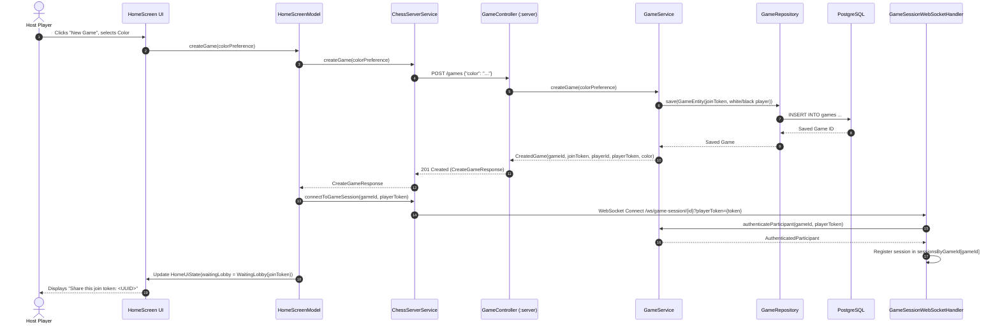

---

## 6.2 Scenario 2: Opponent Joins & Match Starts

This scenario demonstrates the joining flow, mutual WebSocket presence detection, and game start event broadcast.

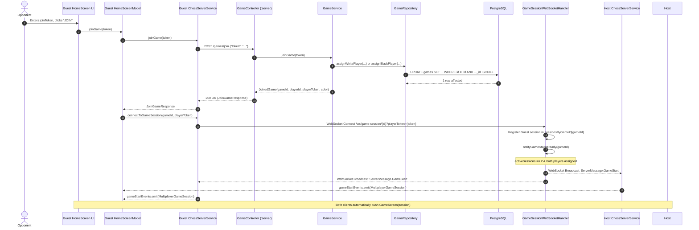

---

## 6.3 Scenario 3: Real-Time Move Execution & Validation

This scenario details how a player makes a move on the board, how the server verifies it authoritatively, and how the new state is propagated.

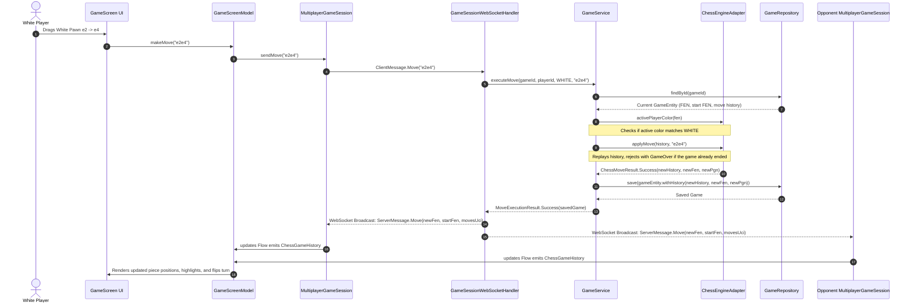

---

## 6.4 Scenario 4: Local Pass-and-Play Gameplay

For local offline gameplay, no network activity occurs:

1. User clicks **"New local Game"** on `HomeScreen`.
2. `HomeScreenModel.createLocalGame()` instantiates an `OfflineGameSession`.
3. `OfflineGameSession` is initialized with an empty `ChessGameHistory` (standard opening FEN, no moves) and delegates move evaluation to `ChessEngineAdapter`.
4. When either player moves:
   - `GameScreenModel.makeMove(moveUci)` invokes `OfflineGameSession.sendMove(moveUci)`.
   - `OfflineGameSession.isTurnAllowed(color)` returns `true` regardless of turn color.
   - `chessEngineAdapter.applyMove(currentHistory, moveUci)` evaluates legality locally.
   - On success, `_updates.emit(result.history)` triggers recomposition on `GameScreen`.
# 7. Deployment View

The deployment view describes the technical infrastructure, target platforms, container topologies, and distribution channels for Cheesse.

---

## 7.1 Infrastructure & Deployment Topology

Cheesse utilizes a hybrid architecture: a containerized, self-hostable reactive backend paired with client applications distributed across desktop, web, and mobile platforms.

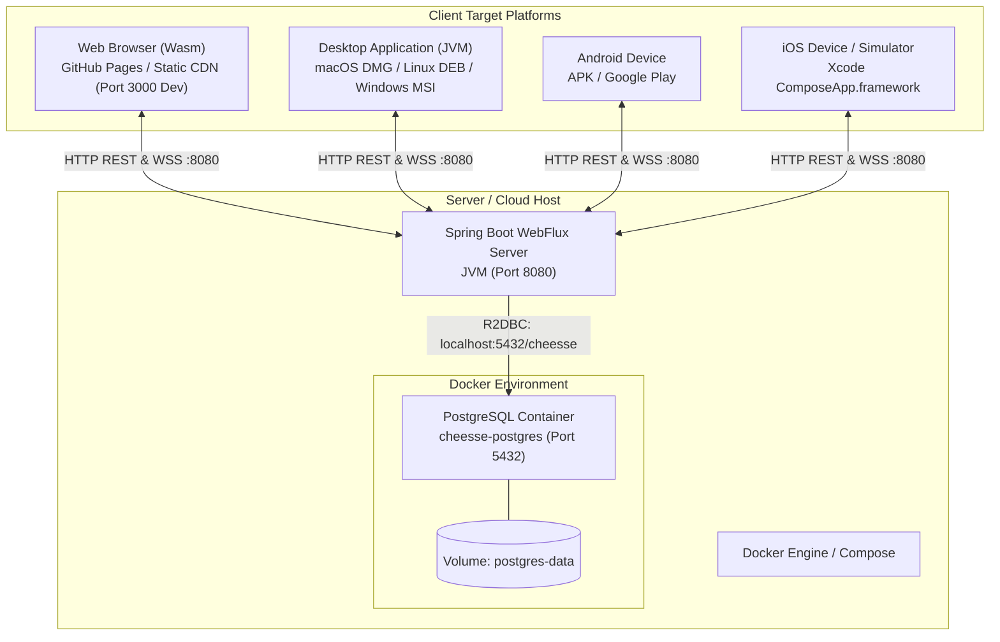

---

## 7.2 Backend & Database Deployment

### 7.2.1 Database Container (`docker-compose.yml`)

The persistence tier runs as a PostgreSQL container (`cheesse-postgres`, port `5432`, database `cheesse`, persistent volume `postgres-data`, `pg_isready` healthcheck) defined in [`docker-compose.yml`](../../docker-compose.yml). The image tag is set there.

### 7.2.2 Backend Application Execution

The Spring Boot backend is compiled into a standalone executable JAR:

- **Build Command**: `./gradlew :server:bootJar`
- **Execution Command**: `java -jar server/build/libs/server-<version>.jar`
- **Environment Configuration**:
  - `DB_HOST`: Hostname of PostgreSQL instance (defaults to `localhost`).
  - `DB_PORT`: Database port (defaults to `5432`).
  - `DB_NAME`: Database name (defaults to `cheesse`).
  - `DB_USERNAME`: Database user (defaults to `postgres`).
  - `DB_PASSWORD`: Database password (defaults to `postgres`).
  - `SERVER_PORT`: HTTP/WebSocket listening port (defaults to `8080`).

---

## 7.3 Multiplatform Client Distribution

| Target Platform | Packaging Format | Build Command | Distribution Channel |
|---|---|---|---|
| **Desktop JVM** | Uber JAR / Native installer (DMG, MSI, DEB) | `./gradlew packageUberJarForCurrentOS` | GitHub Releases / Direct Download |
| **Web (Wasm)** | Wasm executable + JS glue + HTML assets | `./gradlew :composeApp:wasmJsBrowserDistribution` | Static Web Host / GitHub Pages |
| **Android** | Signed APK / Android App Bundle (`.aab`) | `./gradlew :androidApp:assembleDebug` | Google Play Store / Sideloading |
| **iOS** | Static framework (`ComposeApp.framework`) | Xcode Archive via `iosApp.xcodeproj` | Apple TestFlight / App Store |
# 8. Cross-Cutting Concepts

Cross-cutting concepts govern recurring patterns, architectural principles, and shared implementations across multiple modules in Cheesse.

---

## 8.1 Domain Models & Polymorphic Serialization

Cheesse uses `kotlinx.serialization` for communication across HTTP and WebSockets.

### 8.1.1 Polymorphic WebSocket Messages

Real-time WebSocket communication relies on sealed class hierarchies annotated with `@Serializable`:

```kotlin
@Serializable
sealed class ClientMessage {
    @Serializable
    data class Move(val moveUci: String) : ClientMessage()
}

@Serializable
sealed class ServerMessage {
    @Serializable
    data class Move(
        val fen: String,
        val startFen: String? = null, // optional for compatibility with older servers
        val movesUci: List<String> = emptyList(),
    ) : ServerMessage()

    @Serializable
    data class Error(val message: String) : ServerMessage()

    @Serializable
    data object GameStart : ServerMessage()
}
```

- **Compile-Time Safety**: Sealed hierarchies ensure exhaustive handling on both client and server.
- **Backwards Compatibility**: Unknown JSON properties are ignored via `ignoreUnknownKeys = true`.

---

## 8.2 Reactive Concurrency & Streaming

Cheesse relies on asynchronous, non-blocking concurrency throughout both client and server.

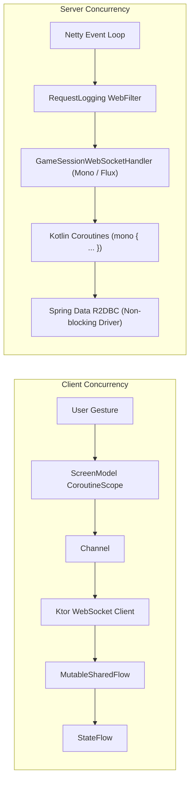

- **Project Reactor & Coroutines Bridge**: Server uses `kotlinx-coroutines-reactor` (`mono { ... }`) to seamlessly interoperate between Project Reactor reactive types (`Mono`, `Flux`) and idiomatic Kotlin suspending functions.
- **Client Reactive Flows**: State is propagated reactively to the UI using `StateFlow` (for current state snapshot) and `SharedFlow` (for event streams).

---

## 8.3 Anonymous Token-Based Security & Authentication

Cheesse intentionally eliminates user registration and credential management while maintaining match integrity.

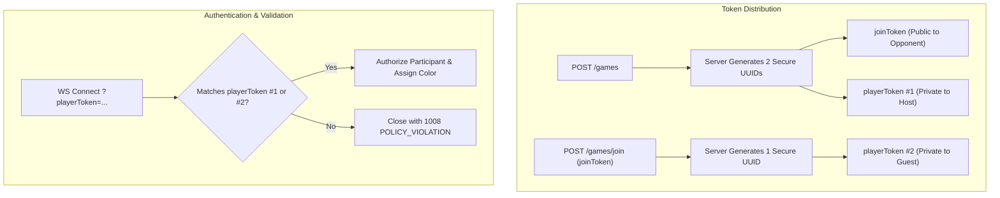

- **Separation of Secrets**: The `joinToken` only authorizes claiming a seat. Once joined, gameplay requires the secret `playerToken`.
- **Token Leakage Prevention**: Responses to clients and WebSocket broadcasts never expose the opponent's `playerToken` or `playerId`.

---

## 8.4 Error Handling & HTTP Status Mapping

Error handling follows a strict separation between transport protocols and domain errors:

### 8.4.1 REST Layer (`GameExceptionHandler`)

Domain exceptions thrown during REST calls are intercepted centrally by `@RestControllerAdvice`:

```kotlin
@RestControllerAdvice
class GameExceptionHandler {
    @ExceptionHandler(GameNotFoundException::class)
    fun handleNotFound(ex: GameNotFoundException): ResponseEntity<Map<String, String>> =
        ResponseEntity.status(HttpStatus.NOT_FOUND).body(mapOf("error" to (ex.message ?: "Not Found")))

    @ExceptionHandler(GameFullException::class)
    fun handleGameFull(ex: GameFullException): ResponseEntity<Map<String, String>> =
        ResponseEntity.status(HttpStatus.CONFLICT).body(mapOf("error" to (ex.message ?: "Conflict")))

    @ExceptionHandler(IllegalArgumentException::class)
    fun handleIllegalArgument(ex: IllegalArgumentException): ResponseEntity<Map<String, String>> =
        ResponseEntity.status(HttpStatus.BAD_REQUEST).body(mapOf("error" to (ex.message ?: "Bad Request")))
}
```

### 8.4.2 WebSocket Layer (`SessionAction`)

WebSocket errors are segregated into recoverable and unrecoverable failures:
- **Recoverable (Turn or Move Violation, Game Already Over)**: Emits `SessionAction.Reply(ServerMessage.Error("It is not your turn"))` (or `"Illegal move: ..."`, `"Game is over: ..."`).
- **Unrecoverable (Auth Failure / Malformed JSON)**: Closes connection with standard WebSocket close codes (`1008 POLICY_VIOLATION` for auth, `1007 BAD_DATA` for malformed JSON).

---

## 8.5 State Management & MVI UI Architecture

The client UI is powered by Voyager `ScreenModel`:

1. **State Immutability**: All states (`HomeUiState`, `GameState`) are immutable data classes.
2. **State Updates via Coroutines**: ViewModels mutate state using `MutableStateFlow.update { ... }` inside `screenModelScope`.
3. **Polymorphic Game Sessions**: The UI binds to `GameSession` polymorphically:
   - `OfflineGameSession.isTurnAllowed(color)` always returns `true`.
   - `MultiplayerGameSession.isTurnAllowed(color)` validates that `color == playerColor`.
   This ensures that UI logic never has to check concrete session types.

---

## 8.6 Persistence & Schema Evolution

Database persistence is handled by Spring Data R2DBC against a single normalized table:

```sql
CREATE TABLE IF NOT EXISTS games (
    id BIGSERIAL PRIMARY KEY,
    fen VARCHAR(255) NOT NULL DEFAULT 'rnbqkbnr/pppppppp/8/8/8/8/PPPPPPPP/RNBQKBNR w KQkq - 0 1',
    pgn TEXT NOT NULL DEFAULT '',
    join_token UUID NOT NULL UNIQUE,
    white_player_id BIGINT,
    white_player_token UUID,
    black_player_id BIGINT,
    black_player_token UUID
);

-- Idempotent upgrade: move history for threefold repetition (ADR-007).
ALTER TABLE games ADD COLUMN IF NOT EXISTS start_fen VARCHAR(255);
UPDATE games SET start_fen = fen WHERE start_fen IS NULL;
ALTER TABLE games ALTER COLUMN start_fen SET DEFAULT 'rnbqkbnr/pppppppp/8/8/8/8/PPPPPPPP/RNBQKBNR w KQkq - 0 1';
ALTER TABLE games ALTER COLUMN start_fen SET NOT NULL;
ALTER TABLE games ADD COLUMN IF NOT EXISTS move_history TEXT NOT NULL DEFAULT '';
```

- **Schema Evolution**: `schema.sql` runs on every startup (`spring.sql.init.mode: always`), so schema changes are written as idempotent `ALTER TABLE ... IF NOT EXISTS` statements below the `CREATE TABLE`. `fen` is a cached copy of the position reached by replaying `start_fen` + `move_history`.

- **Atomic Seat Assignment**: Concurrency-safe SQL queries ensure that two players attempting to join the same match simultaneously cannot double-claim a seat:
  ```sql
  UPDATE games
  SET black_player_id = :playerId, black_player_token = :playerToken
  WHERE id = :gameId AND black_player_id IS NULL;
  ```
  If affected row count is not 1, a `GameFullException` is raised immediately.
# 9. Architecture Decisions (ADRs)

This section records significant architectural decisions (ADRs) made in Cheesse, capturing the context, options considered, decisions, and consequences.

---

## ADR-001: Kotlin Multiplatform & Compose Multiplatform for Cross-Platform UI

- **Status**: Accepted
- **Date**: 2026-09-03
- **Context**: Cheesse requires cross-platform execution on Desktop (JVM), Web (Wasm), Android, and iOS. Implementing distinct native frontends (SwiftUI, Jetpack Compose, React/TypeScript) would quadruple development and maintenance overhead.
- **Decision**: Adopt Kotlin Multiplatform (KMP) and Compose Multiplatform for common code, networking, and UI presentation across all 4 platforms.
- **Consequences**:
  - *Positive*: 100% of UI components, game models, and network serialization logic are shared.
  - *Positive*: Native performance and look-and-feel across all supported devices.
  - *Negative*: WebAssembly (Wasm) tooling requires modern browser support; iOS requires Xcode integration.

---

## ADR-002: Reactive Spring Boot WebFlux & Spring Data R2DBC

- **Status**: Accepted
- **Date**: 2026-09-03
- **Context**: Real-time chess matches require keeping hundreds or thousands of concurrent WebSocket connections open. Traditional blocking servlet threads (Tomcat, standard JDBC) consume excessive system memory and degrade under thread exhaustion.
- **Decision**: Build the `:server` backend using reactive Spring WebFlux and Spring Data R2DBC with Project Reactor and Netty.
- **Consequences**:
  - *Positive*: Ultra-low memory usage and high concurrency handling via Netty's event loop.
  - *Positive*: Asynchronous database I/O to PostgreSQL without blocking application threads.
  - *Negative*: Developers must adhere strictly to non-blocking patterns; no blocking libraries can be introduced.

---

## ADR-003: WebSocket Protocol for In-Game Synchronization

- **Status**: Accepted
- **Date**: 2026-09-03
- **Context**: Moves in a chess game require instant synchronization with minimal transport latency. Polling via HTTP REST introduces unnecessary network overhead and latency delays.
- **Decision**: Use WebSockets (`/ws/game-session/{id}?playerToken={token}`) for bidirectional in-game message dispatch, while retaining REST for stateless lobby operations (`/games`, `/games/join`).
- **Consequences**:
  - *Positive*: Sub-millisecond messaging overhead with full-duplex transmission.
  - *Positive*: Immediate server push for `GameStart`, move updates, and game over states.
  - *Negative*: Persistent connections require connection lifecycle tracking and keep-alive handling.

---

## ADR-004: Unified Multiplatform Chess Engine Abstraction via Shared `ChessEngineAdapter`

- **Status**: Accepted (Updated)
- **Date**: 2026-09-03 (Updated 2026-09-15)
- **Context**: In online and local chess, exposing third-party chess libraries (`chess-core`) directly across WebSocket handlers, screen models, and Compose UI composables tightly couples the entire application to third-party types (`Piece`, `Square`, `GameResult`). Furthermore, untrusted clients must not be trusted for move validation in multiplayer games, yet client UIs require rich board inspection (legal moves, piece positions, captured pieces, and game termination).
- **Decision**: Centralize chess engine operations behind a multiplatform `ChessEngineAdapter` interface (`DefaultChessEngineAdapter`) located in `:shared` with domain models (`ChessPiece`, `ChessPieceType`, `ChessSquare`, `ChessMove`, `ChessGameResult`, `ChessBoardState`). In `:server`, inject `ChessEngineAdapter` into `GameService` for authoritative validation. In `:composeApp`, inject it into `GameScreenModel` and `OfflineGameSession`, removing direct dependencies on `chess-core` from client modules.
- **Consequences**:
  - *Positive*: Total cheat immunity: illegal moves and turn violations are validated authoritatively on the backend.
  - *Positive*: Zero library leakage: Compose UI components and ScreenModels depend only on clean domain models.
  - *Positive*: Single source of truth: shared adapter handles move validation, board state extraction, and captured piece math for all platforms.
  - *Positive*: Unit testable: ScreenModels and backend services can be tested with fakes without executing full engine calculations.
  - *Positive*: Future engine replaceability: swapping `chess-core` for Stockfish or native engines only requires modifying `DefaultChessEngineAdapter`.

---

## ADR-005: Anonymous Token-Based Matchmaking & Authentication

- **Status**: Accepted
- **Date**: 2026-09-03
- **Context**: Requiring registration, email confirmation, and passwords imposes friction that discourages casual players from creating and joining games.
- **Decision**: Implement token-based anonymous authentication. A `joinToken` is public and shared out-of-band to claim a seat. A separate `playerToken` is kept private by each participant to authenticate WebSocket move submissions.
- **Consequences**:
  - *Positive*: Zero friction: matches can be created and joined in seconds.
  - *Positive*: High security: opponent cannot impersonate the other player or guess the 128-bit UUID `playerToken`.
  - *Negative*: If a user clears their browser cache or loses their session without saving the URL, recovering an ongoing match requires re-obtaining the token.

---

## ADR-006: Voyager Navigation & ScreenModel MVI State Management

- **Status**: Accepted
- **Date**: 2026-09-03
- **Context**: Standard Jetpack Compose navigation is Android-centric and cumbersome to configure across multiplatform targets (iOS, Desktop JVM, Wasm).
- **Decision**: Adopt Voyager navigation (`cafe.adriel.voyager`) and `ScreenModel` architecture coupled with Kodein DI.
- **Consequences**:
  - *Positive*: Unified multiplatform screen transitions, backstack management, and ViewModel lifecycles.
  - *Positive*: Clean unidirectional data flow (MVI) with reactive `StateFlow` bindings.
  - *Negative*: ScreenModels must be instantiated via Voyager's DI integration (`rememberScreenModel`).

---

## ADR-007: Persist and Replay Full Move History as the Game State

- **Status**: Proposed
- **Date**: 2026-10-25
- **Context**: `ChessEngineAdapter` operated on FEN strings only. Every call loaded the FEN into a fresh `chess-core` `ChessGame`, which discards all earlier positions, so threefold repetition could never be detected (risk R-02). The stored PGN was also wrong: it only contained the last move.
- **Options Considered**:
  1. Store the current FEN only (status quo): simple, but repetition is undetectable and the PGN is broken.
  2. Store the PGN and replay it via SAN: the column already exists, but existing rows hold broken PGN, `chess-core`'s `loadPgn` does not rebuild position history, and SAN parsing is more fragile than UCI.
  3. Store the start FEN plus the list of UCI moves and replay them for every engine call: needs two new columns and O(n) replay per call, but is exact and works from any start position.
  4. Keep a live `ChessGame` per game in memory: fast, but breaks on restart and with multiple server instances (see R-01).
- **Decision**: Use option 3. `ChessGameHistory(startFen, movesUci)` in `:shared` is the input to `applyMove` and `getBoardState`. The server persists it in `games.start_fen` and `games.move_history` (with `fen` and `pgn` kept as derived caches) and broadcasts it in `ServerMessage.Move` via the optional `startFen` / `movesUci` fields. Clients keep a `ChessGameHistory` instead of a FEN. The adapter rejects moves once the game is over (`ChessMoveResult.GameOver`) and reports no legal moves for finished games.
- **Consequences**:
  - *Positive*: Threefold repetition is detected on server and client; the server stops accepting moves after any draw.
  - *Positive*: PGN now contains the whole game for games starting from the standard position.
  - *Positive*: Backwards-compatible protocol: older clients ignore the new fields, and newer clients fall back to the FEN when talking to an older server.
  - *Negative*: Each engine call replays the game (see R-05), and `ServerMessage.Move` grows with game length.
  - *Negative*: Games already in progress at migration time only count repetitions from their position at migration; `chess-core`'s PGN generation assumes the standard start position.
# 10. Quality Requirements

This section details the quality tree and concrete quality scenarios evaluating how Cheesse satisfies its primary non-functional requirements.

---

## 10.1 Quality Tree

Cheesse's non-functional attributes are categorized based on ISO/IEC 25010:

```mermaid
graph TD
    QualityTree["Cheesse Quality Attributes"]

    QualityTree --> Performance["Performance Efficiency"]
    Performance --> Latency["Move Broadcast Latency (< 100ms)"]
    Performance --> Concurrency["High Concurrent WebSockets (> 1000)"]

    QualityTree --> Portability["Portability"]
    Portability --> CrossPlatform["Consistent UI on JVM, Web, Android, iOS"]
    Portability --> MultiTargetEngines["Target-Specific Ktor HTTP/WS Engines"]

    QualityTree --> Security["Security & Integrity"]
    Security --> CheatPrevention["Server-Authoritative Move Legality"]
    Security --> AuthProtection["Player Token Privacy (No Leakage)"]

    QualityTree --> Reliability["Reliability"]
    Reliability --> GracefulDegradation["WebSocket Connection Failures"]
    Reliability --> SchemaSafety["Atomic Matchmaking Seat Claiming"]

    QualityTree --> Maintainability["Maintainability"]
    Maintainability --> CodeSharing["Single Shared Kotlin Logic (:shared)"]
    Maintainability --> AutomatedTests["Integration Tests with Testcontainers"]
```

---

## 10.2 Quality Scenarios

| ID | Quality Attribute | Stimulus & Source | Environment | Expected Response | Measurement / Metric |
|---|---|---|---|---|---|
| **QS-01** | **Move Broadcast Latency** | Player executes a piece move on the client board. | Normal network conditions, 2 concurrent players connected via WebSockets. | The move is transmitted, validated by `ChessEngineAdapter`, persisted to PostgreSQL, and broadcast to the opponent. | Total roundtrip time from client move dispatch to opponent board update is `< 100ms`. |
| **QS-02** | **Cheat Resistance (Illegal Move)** | A compromised or modified client transmits an illegal UCI move (e.g., `e2e5` for a pawn). | Active multiplayer match. | Server rejects the move, leaves the board state unchanged, and emits a targeted `ServerMessage.Error`. | Zero invalid board states committed to the database; opponent receives no move broadcast. |
| **QS-03** | **Cheat Resistance (Turn Order)** | Black player transmits a move while it is White's turn to play. | Active multiplayer match. | Server rejects the move immediately before invoking the chess engine. | Response: `ServerMessage.Error("It is not your turn")`; match state unmodified. |
| **QS-04** | **Unauthorized WebSocket Connection** | An attacker attempts to connect to `/ws/game-session/{id}` with an invalid or empty `playerToken`. | Running server instance with active game sessions. | Handshake is rejected during authentication; socket connection is terminated immediately. | Connection closed with status `1008 POLICY_VIOLATION`. No game state leaked. |
| **QS-05** | **Race Condition on Lobby Joining** | Two players attempt to join the same single-slot game lobby simultaneously using the same `joinToken`. | Normal network, concurrent HTTP requests. | Relational database atomic query `assignBlackPlayer` (or `assignWhitePlayer`) with `WHERE ... IS NULL` allows exactly one player to claim the seat. | First player receives `200 OK`; second player receives `409 Conflict`. No corrupt game seats. |
| **QS-06** | **Cross-Platform Visual Parity** | A game is played between a Desktop JVM user and a Web Wasm user. | Cross-target deployment. | Both clients render the identical board position, piece glyphs, active turn indicator, and capture lists. | 100% visual and logical parity across targets. |
# 11. Risks and Technical Debt

This section outlines known technical risks, architectural trade-offs, and tracked technical debt in Cheesse, along with planned mitigation strategies.

---

## 11.1 Identified Technical Risks

| Risk ID | Risk Title | Severity | Impact | Mitigation Strategy |
|---|---|---|---|---|
| **R-01** | **In-Memory Session Registry (Horizontal Scaling Limit)** | Medium | `GameSessionWebSocketHandler` keeps WebSocket sessions in an in-memory `ConcurrentHashMap<Long, MutableSet<WebSocketSession>>`. If the backend is scaled horizontally across multiple instances behind a load balancer, two players in the same game connected to different backend instances cannot exchange messages. | Introduce a Redis Pub/Sub or RabbitMQ messaging broker to distribute WebSocket broadcasts across multiple backend nodes. |
| **R-02** | **Threefold Repetition Detection via FEN Alone** | Resolved | A FEN string does not capture earlier positions, so threefold repetition was never detected. | Resolved by ADR-007: games persist `start_fen` + `move_history` and the adapter replays the full history. Games started before the migration only count repetitions from the position they had at migration time. |
| **R-05** | **Full History Replay per Move** | Low | Every `applyMove` / `getBoardState` call replays the entire game, so cost grows linearly with game length (chess-core regenerates legal moves per replayed move). Negligible for normal game lengths. | If profiling shows a problem, cache a live `ChessGame` per game session inside the adapter layer. |
| **R-03** | **Unbounded Database Growth from Abandoned Lobbies** | Medium | When users create games but never share the `joinToken`, or when players abandon games midway through, entries remain in the `games` table indefinitely. | Implement a background scheduled cleanup job (`@Scheduled`) to evict or archive inactive games older than 24 hours. |
| **R-04** | **Reconnection & Network Flakiness** | Medium | If a mobile client loses cellular connection briefly, the WebSocket drops. Currently, the client must re-open the match manually. | Implement automatic client-side exponential backoff reconnection in `ChessServerService` with session resumption tokens. |

---

## 11.2 Tracked Technical Debt

### 1. Game Clock & Time Constraints
- **Current State**: Games have no time limit; players can take unlimited time to move.
- **Remediation Plan**: Introduce a game time control parameter (e.g., 3+2 Blitz, 10+0 Rapid) at lobby creation. Track remaining player clock time server-side and deduct duration between move timestamps.

### 2. Resignation & Draw Offer Protocol
- **Current State**: Players can only end games through checkmate or board-detected draws.
- **Remediation Plan**: Add `ClientMessage.Resign` and `ClientMessage.OfferDraw` / `AcceptDraw` variants to the shared message protocol.

### 3. Shareable Direct Links
- **Current State**: Opponents must manually copy and paste the join token into a text field.
- **Remediation Plan**: Support deep linking (e.g., `https://cheesse.app/join/{token}`) so opponents can join instantly with one click.
# 12. Glossary

This glossary defines the domain and technical terminology used throughout Cheesse's architecture and codebase.

---

## 12.1 Chess Domain Terminology

| Term | Definition |
|---|---|
| **FEN (Forsyth–Edwards Notation)** | A standard compact notation system for describing a particular board position of a chess game in a single line of text (e.g., piece placement, active color, castling availability, en passant target, halfmove clock, and fullmove number). |
| **PGN (Portable Game Notation)** | A standard plain text format for recording chess matches (both the moves and related metadata such as players, event, and result). |
| **UCI (Universal Chess Interface)** | An open communication protocol that represents moves using algebraic coordinate pairs indicating the starting and ending squares (e.g. `e2e4`, `g1f3`, or `e7e8q` for promotion). |
| **Checkmate** | A game position in which a player's king is under immediate attack (in check) and there is no legal move to escape the attack. Results in an immediate win for the attacker. |
| **Stalemate** | A game position in which the player whose turn it is to move has no legal moves and their king is not in check. Results in a draw. |
| **Threefold Repetition** | A rule stating that a game is drawn if the identical board position (including turn and castling/en-passant rights) occurs three times during the match. |
| **Promotion** | When a pawn reaches the eighth rank, it is converted to the player's choice of a Queen, Rook, Bishop, or Knight of the same color. |

---

## 12.2 Technical & Architectural Terminology

| Term | Definition |
|---|---|
| **Join Token** | A unique 128-bit UUID generated when a multiplayer lobby is created. Shared out-of-band by the host player so an opponent can claim the open seat. |
| **Player Token** | A private 128-bit UUID issued exclusively to an authenticated participant (Host or Guest). Required as a query parameter when connecting to the match WebSocket to prevent unauthorized move injection. |
| **Kotlin Multiplatform (KMP)** | A technology developed by JetBrains enabling developers to write single-source Kotlin logic that compiles to multiple targets (JVM, JavaScript, Wasm, iOS native, Android). |
| **Compose Multiplatform** | A declarative UI toolkit for Kotlin, extending Google's Jetpack Compose to Desktop, Web (Wasm), Android, and iOS. |
| **Spring WebFlux** | The non-blocking reactive web framework introduced in Spring Framework 5, built on Project Reactor and Netty. |
| **R2DBC** | Reactive Relational Database Connectivity. A non-blocking API specification for relational databases in asynchronous, event-driven architectures. |
| **Voyager** | A multiplatform navigation library for Compose supporting tabs, bottom sheets, screens, transitions, and `ScreenModel` lifecycle management. |
| **ScreenModel** | Voyager's multiplatform equivalent of Android's `ViewModel`, managing screen-scoped coroutine lifecycles and reactive states. |
| **Kodein DI** | A lightweight, fast multiplatform dependency injection framework for Kotlin. |
| **ChessEngineAdapter** | A multiplatform domain port/adapter in `:shared` isolating third-party chess library operations (`chess-core`) from the server, client ViewModels, and Compose UI layers. |
